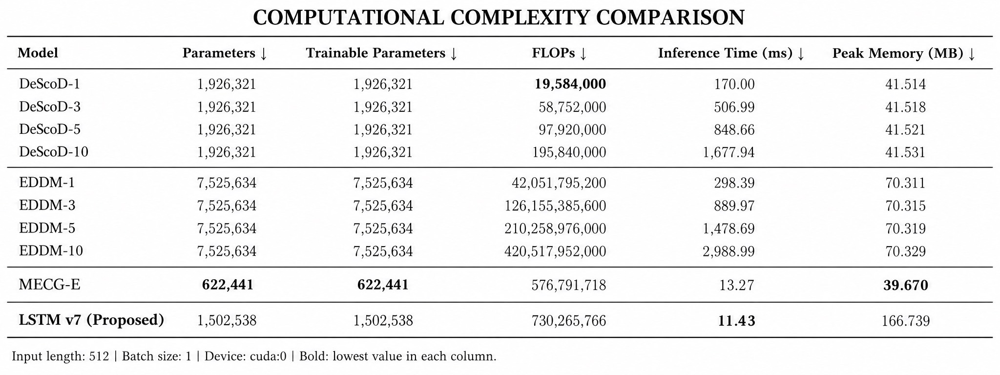
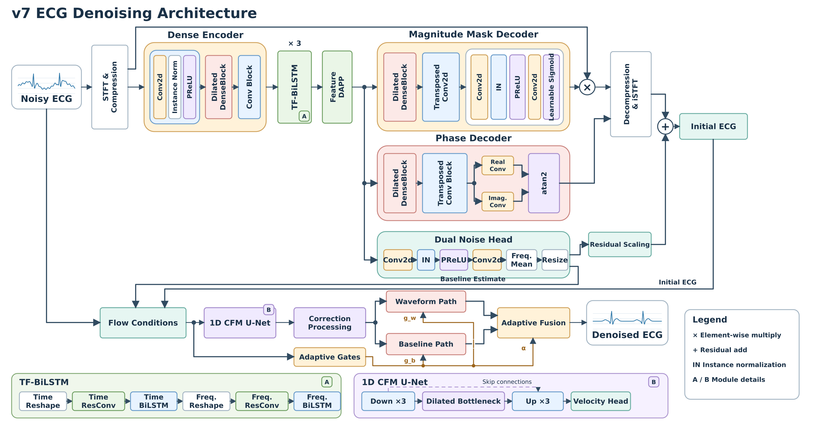
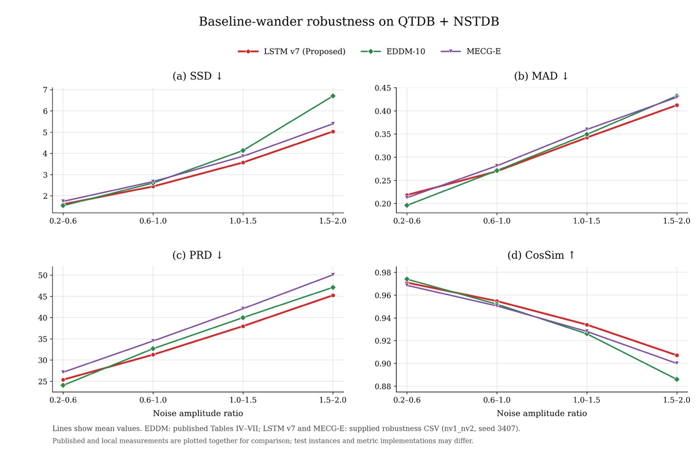
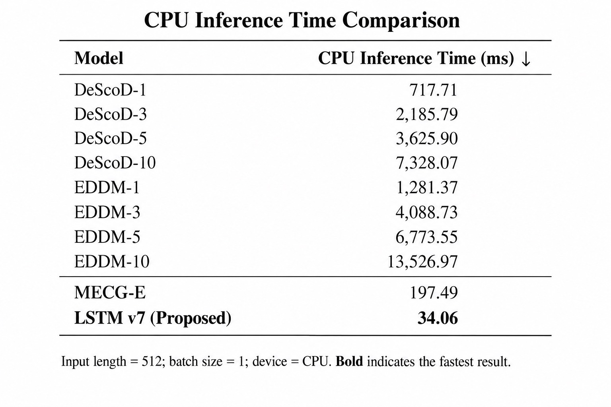

# ResLSTM-Flow: Residual-Context Dual-Path LSTM with Flow Matching for ECG Baseline Wander Removal

### Abstract

ResLSTM-Flow is an ECG denoising model designed to remove baseline wander while preserving cardiac waveform morphology. It combines direct waveform restoration with residual correction to address low-frequency drift and refine the recovered signal. With a single refinement step by default, the model aims to balance denoising quality and inference efficiency for ECG signals affected by varying levels of baseline interference.





## Pre-requisites

1. Download this repository and open a terminal in its root directory.
2. Set up a separate environment as described below.
3. Download [QTDB](https://physionet.org/content/qtdb/1.0.0/) and [NSTDB](https://physionet.org/content/nstdb/1.0.0/), and arrange the records as follows:

   ```text
   data/mecge_table1_repro/raw/
   ├── QTDB/     # sel*.dat, sel*.hea, sel*.pu1
   └── NSTDB/    # bw.dat, bw.hea
   ```

**Datasets and pretrained weights are not included. Users must download the data and train their own model.**

## Installation

#### Requirement

- PyTorch 2.2.2 with matching torchaudio 2.2.2.
- Bash on Linux or WSL for the complete experiment scripts.
- An NVIDIA GPU with a compatible driver and CUDA-enabled PyTorch is recommended. Training and inference use `cuda:0` by default; CPU execution is optional.

#### Environment installation

1. Create and activate an environment:

   ```bash
   python3 -m venv .venv
   source .venv/bin/activate
   ```

2. Install CUDA-enabled PyTorch using the [official version guide](https://pytorch.org/get-started/previous-versions/). The following example uses the CUDA 12.1 build; select a build compatible with your GPU and driver:

   ```bash
   python -m pip install torch==2.2.2 torchaudio==2.2.2 --index-url https://download.pytorch.org/whl/cu121
   ```

3. Install the dependencies:

   ```bash
   python -m pip install -r requirements.txt
   ```

## Code Usage

### Training

Set the experiment name in your Bash terminal:

```bash
MODEL=lstm_dualpath_dapp_cfm_unet_bd_no_attention_v7_resconvctx_30epoch_no_patience
```

The configuration is `src/configs/mecge_table1_repro_${MODEL}.yaml`. After downloading the raw records, prepare the datasets and train:

```bash
bash scripts/run_mecge_table1_repro.sh --model "$MODEL" --nv all --seed 3407 --device cuda:0 --prepare-raw
```

This creates `dataset_bw_nv1.pkl`, `dataset_bw_nv2.pkl`, and matching `rnd_test_nv*.npy` files under `data/mecge_table1_repro/raw/`. Keep these files together. Once prepared, omit `--prepare-raw` on subsequent runs.

Training also runs testing and result aggregation. Add `--resume` to continue training. To run on CPU, replace `--device cuda:0` with `--device cpu` in the execution commands. Always specify `--model "$MODEL"` to select this experiment.

### Testing

Evaluate your trained weights with the original testing option:

```bash
bash scripts/run_mecge_table1_repro.sh --model "$MODEL" --nv all --seed 3407 --device cuda:0 --skip-train
```

Existing prediction files are reused according to the original script. To explicitly regenerate predictions from trained weights:

```bash
FORCE_RERUN=1 bash scripts/run_mecge_table1_repro.sh --model "$MODEL" --nv all --seed 3407 --device cuda:0 --skip-train
```

### Evaluate the Result

Metrics and comparison tables are generated under `runs/mecge_table1_repro/analysis/`. Combined NV1+NV2 results require both predictions and their matching noise-level arrays.

The following figures show supplied results from earlier experiments. **LSTM v7 (Proposed)** refers to ResLSTM-Flow. The robustness figure combines published EDDM values with local measurements, as noted in its caption.






<details>
<summary>Additional workflows</summary>

#### Stage analysis and complexity

```bash
bash scripts/analyze_model_stages.sh --model v7 --nv 1 --seed 3407 --indices 0 10 100 --device cuda:0
bash scripts/run_mecge_table1_complexity_test.sh --model "$MODEL" --device cuda:0 --no-cpu --output-root "$PWD/runs/mecge_table1_repro/complexity_test"
```

Stage analysis compares the full pre-flow reconstruction against the final flow-refined output and exports PNG, NPZ, CSV, and a manifest. It supports the main single-step v7 configuration. The explicit complexity output path keeps generated files in this workspace.

#### Ablations and inference variants

```bash
bash scripts/run_mecge_table1_repro.sh --model "${MODEL}_no_flow" --nv all --seed 3407 --device cuda:0
bash scripts/run_mecge_table1_repro.sh --model "${MODEL}_step4" --nv 1 --seed 3407 --device cuda:0
```

Training ablations: `no_flow`, `flow_only`, `no_dual_noise_head`.
Inference variants: `step4`, `step8`, `step1_3shot`, `step1_5shot`, `step1_10shot`, their `_median` variants, and `step1_10shot_antithetic_mean`. Inference variants require the main model checkpoint for the same NV and seed.

#### Custom inference and statistics

```bash
python src/inference.py --config "src/configs/mecge_table1_repro_${MODEL}.yaml" --checkpoint /path/to/best_model.pt --input /path/to/input.npz --output-dir runs/custom_inference --device cuda:0
```

The NPZ contains `noisy_ecg` or `input` shaped `[N,512]` or `[N,1,512]`; optional `clean_reference` or `target` enables paired metrics. Custom strength/frequency sweeps use `src/experiment_suite.py`, and statistical comparisons use `src/result_analysis.py`. See each original tool's `--help` for its input requirements.

#### Regression tests

```bash
python -B -m unittest discover -s tests -p 'test_v7_stage_analysis.py'
```

</details>

## License

Inherited MECG-E code is covered by its [upstream MIT license](https://github.com/khhungg/MECG-E/blob/main/LICENSE). A separate license for the project-specific additions has not been supplied.

## Citation

For the upstream method, see [MECG-E: Mamba-based ECG Enhancer for Baseline Wander Removal](https://arxiv.org/abs/2409.18828). No separate publication citation is provided for ResLSTM-Flow.

## Acknowledgments

We acknowledge the [MECG-E](https://github.com/khhungg/MECG-E) authors and QTDB/NSTDB contributors. ResLSTM-Flow is the display name for the original v7 experiment; its code, settings, scripts, and dependency versions are preserved.
